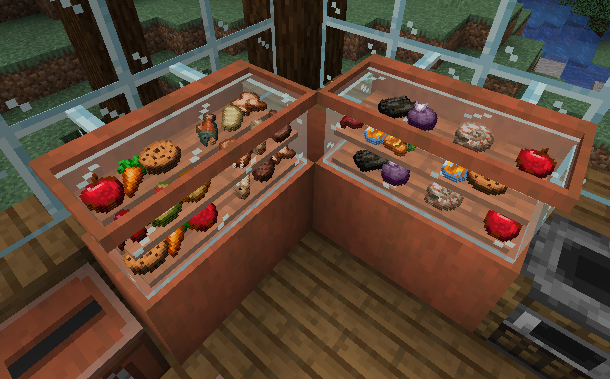
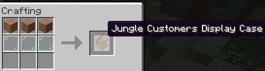
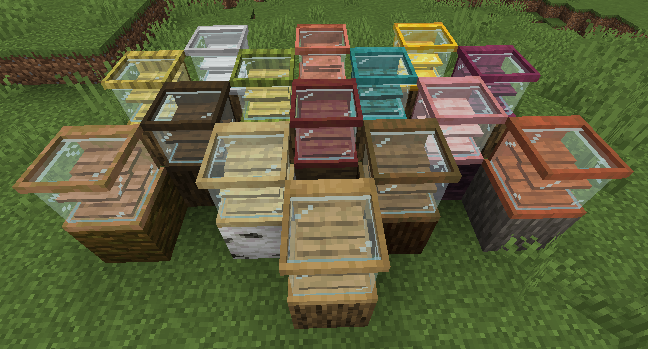
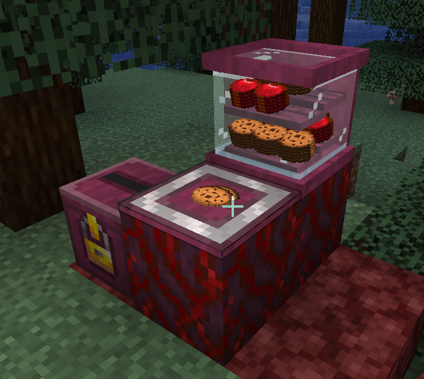

## Customer Display Cases



Customer display cases provide twelve storage slots arranged across two shelves.
Each shelf holds three item stacks along its back and three along its front, and
stored stacks are visible through the glass.

Matching display cases placed side by side with the same facing visually join
into a continuous case.

### Crafting Display Cases



Display cases are available in the same iron, copper, gold, wood, stem, and
bamboo variations as customer pickup counters.

Wood, stem, and bamboo display cases are crafted with one matching stripped log,
stripped stem, or bamboo block, two matching planks, and three glass panes:

```text
Variant Block | Matching Planks | Matching Planks
Glass Pane    | Glass Pane      | Glass Pane
```

Metal display cases use one matching metal block, two matching ingots, and three
glass panes:

```text
Metal Block | Matching Ingot | Matching Ingot
Glass Pane  | Glass Pane     | Glass Pane
```

The following variants are available:

* Iron, made with one iron block and two iron ingots
* Copper, made with one copper block and two copper ingots
* Gold, made with one gold block and two gold ingots
* Oak, spruce, birch, jungle, acacia, dark oak, mangrove, and cherry, made
  with one matching stripped log and two matching planks
* Crimson and warped, made with one matching stripped stem and two matching
  planks
* Bamboo, made with one bamboo block and two bamboo planks
* Stripped bamboo, made with one stripped bamboo block and two bamboo planks

Each variation uses textures matching its primary block and planks, allowing
display cases to coordinate with the materials used in a shop, restaurant,
market stand, or other build.



### Display Cases and Pickup Counters Automation



Hoppers can insert into and extract from display cases like other containers.
Pickup counters also pull wanted items from display cases directly beside them
at the same height. Only the item and quantity currently wanted by customers
are moved, and transferred items are credited to **Automated**.
